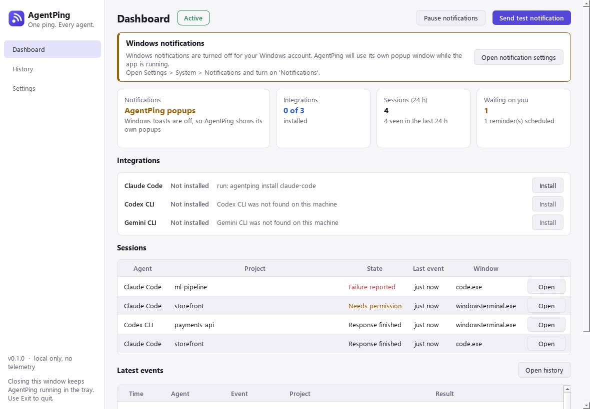
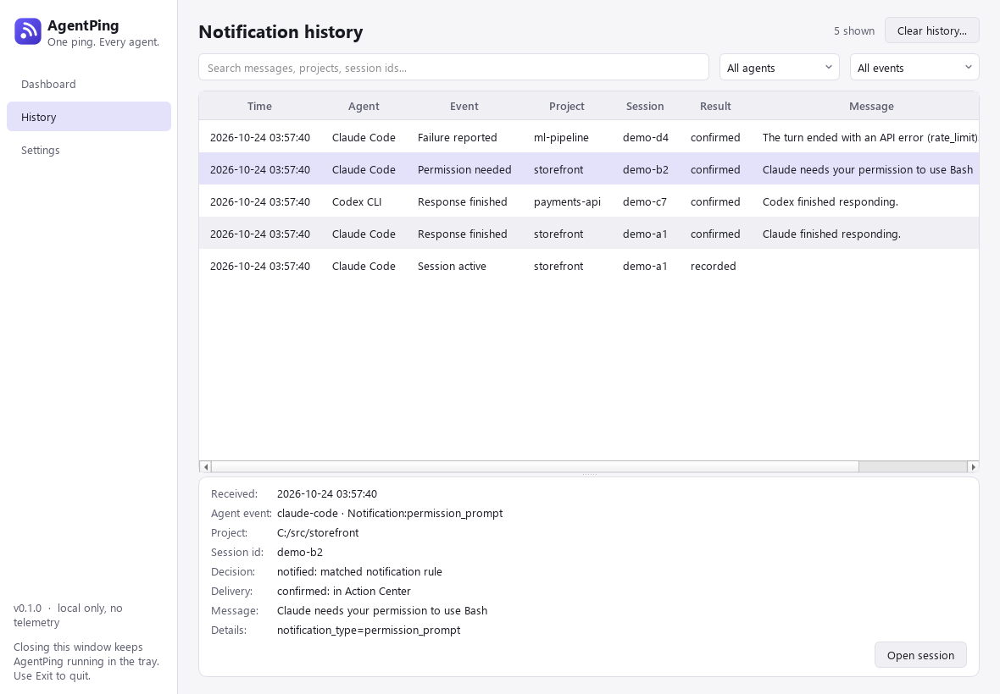
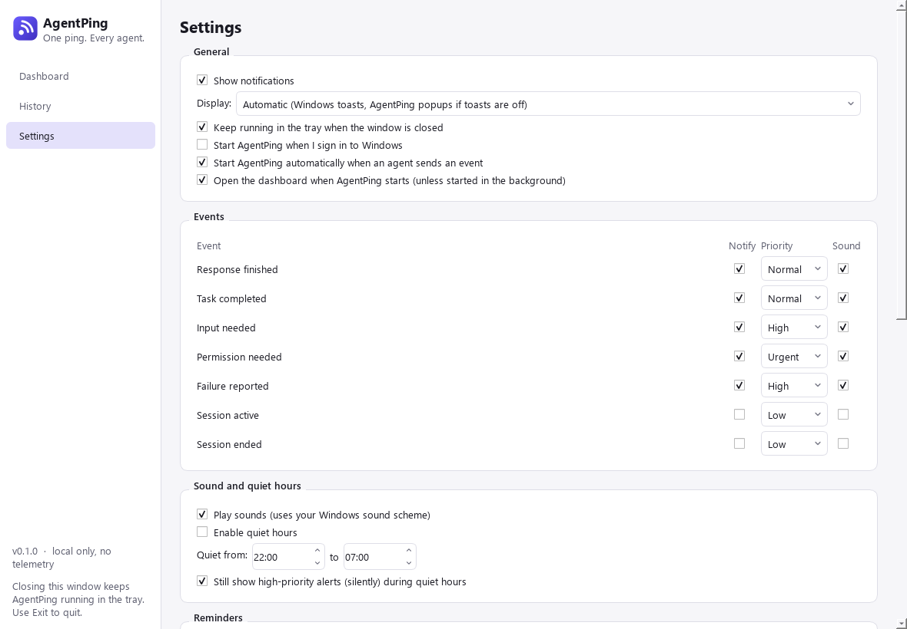
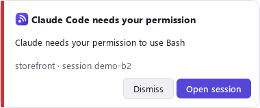

<p align="center"></p>

<h1 align="center">AgentPing</h1>
<p align="center"><b>One ping. Every agent.</b><br>
Local-first desktop notifications and attention management for AI coding agents on Windows.</p>

> **Status: alpha (v0.1.0).** Windows 10/11 only. "AgentPing" is a provisional name:
> other projects already use it (see [docs/ROADMAP.md](docs/ROADMAP.md#naming)).

You start a long task in Claude Code, switch to the browser, and miss the moment the
agent finishes, fails, or stops to ask permission. With several agents in several
repositories it gets worse. AgentPing tells you, with a desktop notification, **which
agent** in **which project and session** needs you, and takes you back to that window
with one click.



<sub>Screenshots are rendered from the real app (`scripts/screenshots.py`) using labelled
demo events. The banner is genuine: the screenshot machine has Windows notifications
turned off, so AgentPing falls back to its own popups.</sub>

## What it does

- **Native Windows notifications** (toasts), with an **AgentPing popup fallback** when
  Windows notifications are turned off or blocked. Delivery is reported honestly as
  *confirmed* (in Action Center), *dispatched*, *failed* or *unavailable*.
- **Correct event semantics.** "Claude finished responding" is not reported as "task
  completed". Permission and input requests are separate, higher-priority alerts.
- **Session awareness.** Concurrent sessions are tracked separately, even in the same folder.
- **Click to return.** Focuses the terminal or editor window that runs the session. If
  that isn't possible, it shows the project path and session details instead.
- **Attention management.** Per-event priorities and sounds, quiet hours, pause/resume,
  per-agent switches, duplicate suppression, and **reminders** for unanswered permission
  or input requests. Reminders stop as soon as the session moves on, and never repeat
  forever.
- **Tray app** with a dashboard, searchable history, and settings.
- **Safe installer.** Backs up agent settings, preserves every unrelated hook and setting,
  is idempotent, and is fully reversible.
- **Private by design.** No cloud, no account, no LLM, no telemetry. Prompts, code, tool
  arguments and transcripts are never stored.

## Supported agents

| Agent | Mechanism | Status |
|---|---|---|
| **Claude Code** | Official [hooks](https://code.claude.com/docs/en/hooks) (`~/.claude/settings.json`) | **Verified** against a real Claude Code 2.1.309 install: real session start, response finished and session end events produced notifications, and concurrent sessions stayed separate. Permission/input events are tested with documented payloads. |
| **Codex CLI** | Official [hooks](https://developers.openai.com/codex/hooks) (`~/.codex/hooks.json`) | Implemented and contract-tested with documented payloads. **Not verified** against a real install (Codex was not available). Codex requires you to trust the hooks via `/hooks`. |
| **Gemini CLI** | Official [hooks](https://github.com/google-gemini/gemini-cli/blob/main/docs/hooks/index.md) (`~/.gemini/settings.json`) | Implemented and contract-tested with documented payloads. **Not verified** against a real install. Reminders are disabled for Gemini by design (see [INTEGRATIONS](docs/INTEGRATIONS.md#gemini-cli)). |
| **Anything else** | `agentping send` (generic, authenticated local interface) | Implemented and tested. |

Details, event mappings and limitations: [docs/INTEGRATIONS.md](docs/INTEGRATIONS.md).

## Install

Requirements: Windows 10 or 11. Python 3.12+ is needed only when installing from source.

**From a release zip** (unsigned, see [SmartScreen notes](docs/INSTALLATION.md#smartscreen-and-antivirus)):

```powershell
.\scripts\install.ps1 -Zip .\AgentPing-0.1.0-win64.zip
```

**From source:**

```powershell
git clone <this repository>; cd agentping
.\scripts\build.ps1            # builds dist\AgentPing\ (runs the tests first)
.\scripts\install.ps1          # installs to %LOCALAPPDATA%\Programs\AgentPing
```

Or, for development: `pip install -e ".[dev]"`, then use the `agentping` command.

The installer installs hooks for every agent it detects. To install manually:

```powershell
agentping install claude-code      # or codex, gemini-cli; no name = all detected
agentping integrations             # check status
```

## Use

```powershell
agentping run                  # start the tray app (dashboard, reminders, popups)
agentping test-notification    # send a labelled test through the real pipeline
agentping doctor               # diagnose notifications, integrations, config, database
agentping history              # recent events (also in the app's History page)
agentping pause / resume       # pause notifications
agentping send --provider my-build --category TASK_COMPLETED --message "Build finished"
agentping quit                 # exit the tray app
```

Closing the window keeps AgentPing in the tray. Use **Exit** in the tray menu (or
`agentping quit`) to stop it. If the app isn't running when an agent event arrives, the
hook starts it in the background.

| History | Settings | Popup |
|---|---|---|
|  |  |  |

## Troubleshooting

Start with `agentping doctor`. Common issues (no notifications appear, Focus Assist, VS
Code tabs, Codex trust prompts) are covered in
[docs/TROUBLESHOOTING.md](docs/TROUBLESHOOTING.md).

## What data is stored

Everything stays in `%LOCALAPPDATA%\AgentPing`:

| File | Contents |
|---|---|
| `config.toml` | Your settings |
| `agentping.db` | Event history (time, agent, event type, project path, session id, short sanitized message, delivery result) and session state. 30-day retention by default. |
| `logs\` | Rotating logs, redacted. No prompts, tool input or payloads. |
| `backups\` | Copies of agent settings files taken before AgentPing edits them |
| `ipc.key` | Random key that authenticates local hook connections |

Notifications contain the agent name, project folder name and a short system message.
A preview of the agent's last message is **off** by default. See
[docs/SECURITY.md](docs/SECURITY.md).

## Uninstall

```powershell
.\scripts\uninstall.ps1             # removes hooks, registrations, program; keeps history
.\scripts\uninstall.ps1 -PurgeData  # also deletes history and preferences
```

Only AgentPing's own hook entries are removed; other tools' hooks are untouched.

## How it compares

Basic "agent finished" notifications are not new. Projects such as
[ai-agent-notifier](https://github.com/DevinoSolutions/ai-agent-notifier),
[code-notify](https://libraries.io/npm/code-notify),
[toasty](https://github.com/shanselman/toasty),
[cc-notification](https://github.com/kmio11/cc-notification) and
[ccnudge](https://github.com/RonitSachdev/ccnudge) cover parts of this, and Claude Code
itself can emit terminal notifications. AgentPing's focus is a **unified, local-first
attention layer**: one event contract across agents, separate session tracking, distinct
permission/input alerts, safe reminder escalation, click-to-return, history, and an
installer that never clobbers your settings. Features and maturity differ between these
projects, so pick what fits.

## Limitations

- Windows only (the notification and window-focus layers sit behind interfaces for future ports).
- Click-to-return focuses the terminal or editor *window*, not a specific tab or pane.
- Reminders and popups need the tray app running. In headless fallback mode (app
  disabled), notifications are delivered without reminders.
- Codex and Gemini CLI integrations are not yet verified against real installations.
- Builds are not code-signed, so SmartScreen may warn on first run.

## Contributing

See [CONTRIBUTING.md](CONTRIBUTING.md), [docs/ARCHITECTURE.md](docs/ARCHITECTURE.md) and
the [example adapter](docs/examples/example_adapter.py). Security issues:
[SECURITY.md](SECURITY.md).

## License

[MIT](LICENSE)
